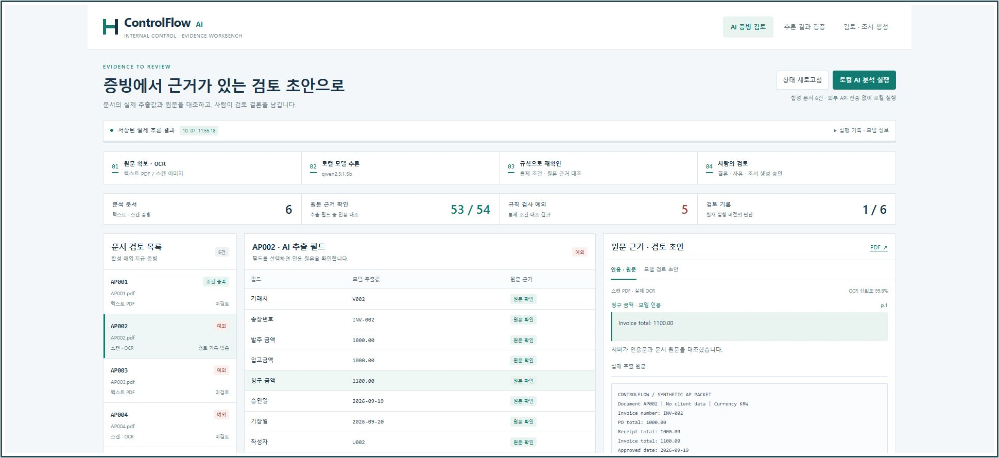
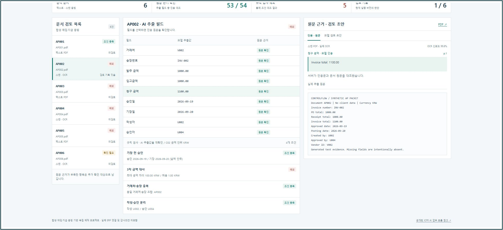
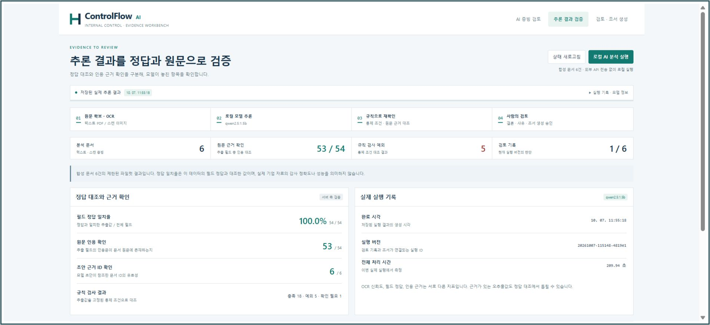
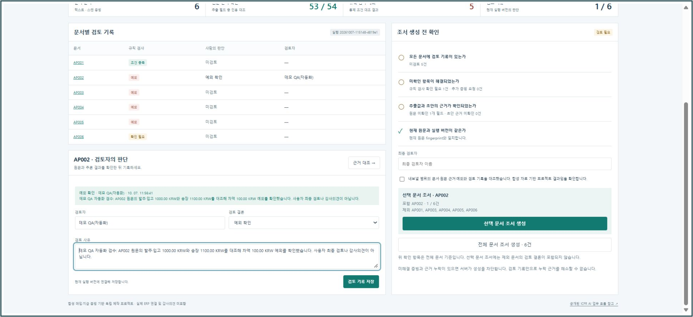
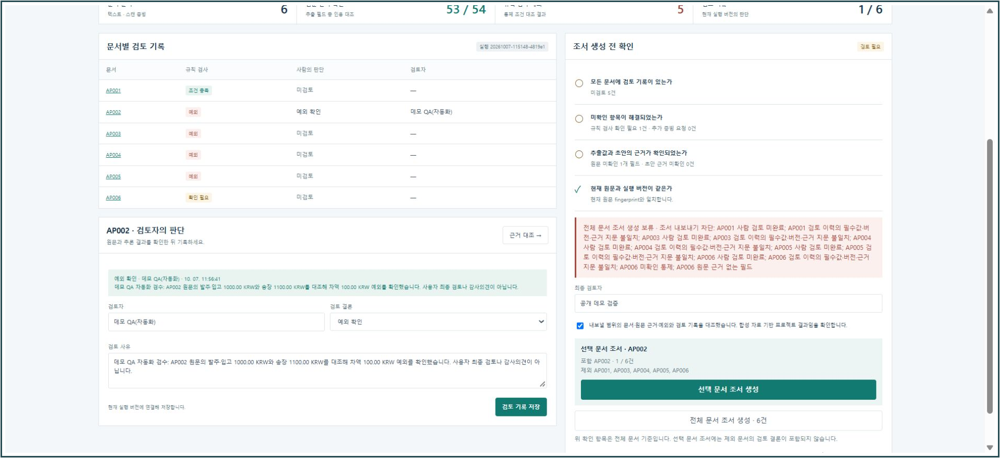
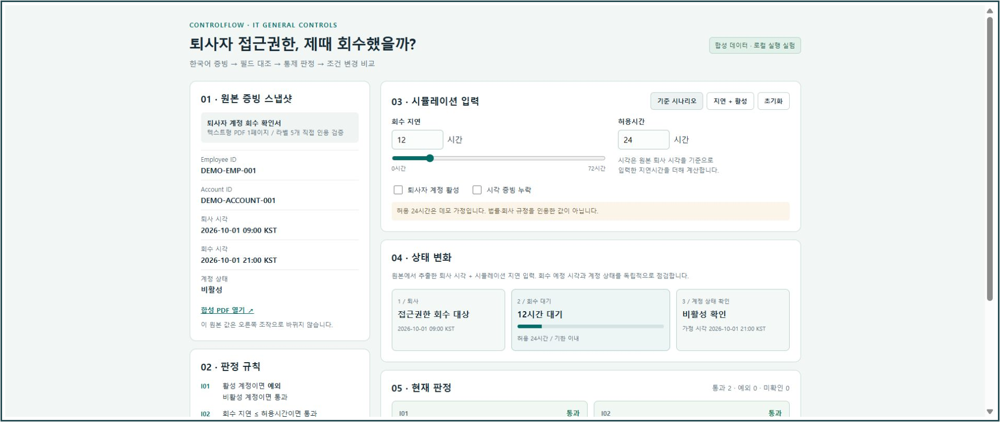
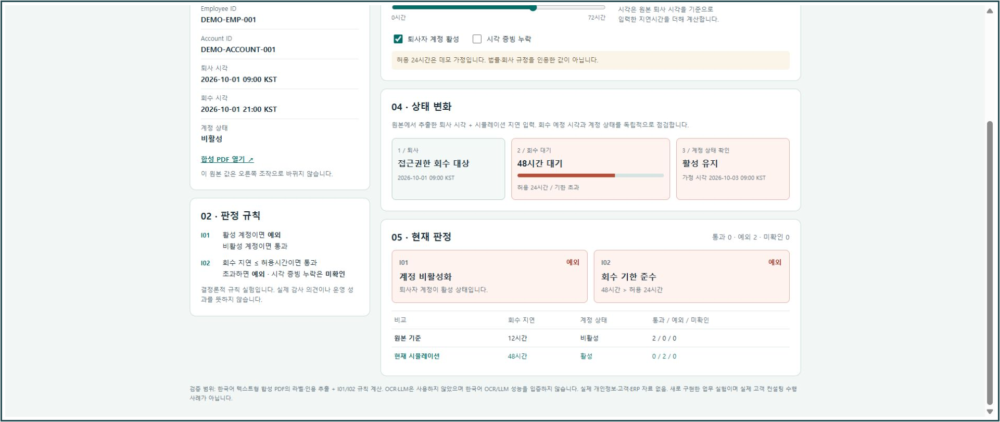
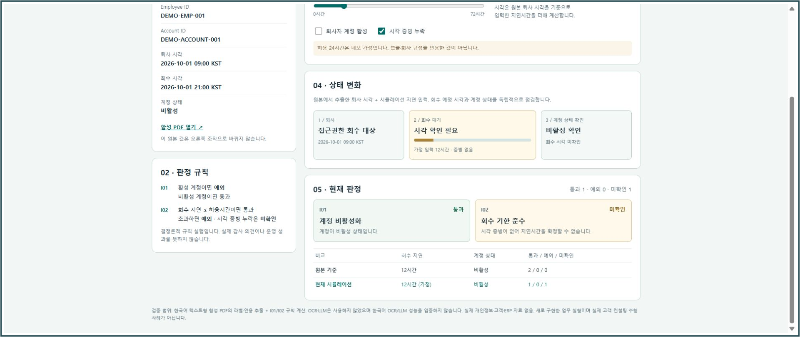
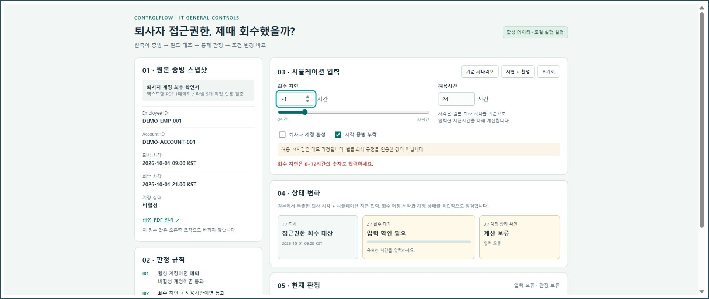
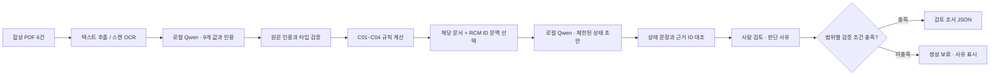

# ControlFlow AI

**PDF 증빙을 읽고, 금액·승인·중복을 대조하고, 사람이 근거를 확인한 뒤 조서를 내보내는 로컬 내부통제 실험.**

매입 담당자가 발주서·입고 내역·송장을 함께 확인하는 상황을 작은 합성 데이터로 구현했습니다. 스캔 PDF에는 실제 OCR을 실행하고, 로컬 Qwen 모델이 추출한 값에는 원문 인용을 붙입니다. 코드가 통제 조건을 계산하면 검토자는 해당 문서와 근거를 대조해 판단을 기록합니다.

예를 들어 **AP002는 발주 1,000원, 입고 1,000원인데 청구금액은 1,100원**입니다. 세 금액의 최대 차이 100원은 이 데모의 허용 차이 1원을 넘습니다. 따라서 금액 통제는 `exception`이 되고, 검토자가 예외를 확인해도 통제 결과 자체가 정상으로 바뀌지는 않습니다.



*전체 작업 화면. 문서 목록에서 건을 선택하고 추출값·통제 결과·원문 근거를 함께 확인합니다.*

아래 AP 화면은 **저장된 실제 OCR·로컬 모델 실행 결과를 다시 연 캡처**입니다. 이번 화면 촬영을 새로운 추론 실행으로 표시하지 않습니다. 검토 화면의 `데모 QA(자동화)` 기록은 기능 확인을 위한 테스트 기록입니다.

이 저장소는 **합성 자료를 사용한 개인 제작 프로젝트**입니다. AI 코딩 도구의 도움을 받아 설계·구현·문서화를 진행했습니다. 실제 고객 자료나 ERP 연결을 포함하지 않으며, 감사 의견 또는 운영 환경의 정확도를 입증하는 결과가 아닙니다.

[화면으로 사용법 보기](#화면으로-따라가기) · [로컬 실행](#로컬-실행) · [구조와 검증 자세히 보기](docs/ARCHITECTURE.md) · [재현 체크리스트](docs/VERIFICATION.md)

## 어떤 업무를 다루나요?

이 프로젝트에서 **AP**는 매입·매입채무 업무, **ICFR**은 재무보고 내부통제, **RCM**은 위험과 통제 절차를 연결한 목록을 뜻합니다. 조서는 어떤 증빙으로 무엇을 확인했는지 남기는 검토 기록입니다.

| 점검 | 코드가 확인하는 조건 | 합성 사례 |
|---|---|---|
| C01 · 기장 전 승인 | 승인일 ≤ 기장일. 날짜 단위 비교 | AP003은 기장 후 승인 |
| C02 · 3자 금액 대사 | 발주·입고·청구금액의 최대 차이 ≤ KRW 1.00 | AP002는 100원 차이 |
| C03 · 거래처·송장 중복 | 거래처 ID + 송장번호가 전체 6건에서 유일 | AP004와 AP005는 같은 조합 |
| C04 · 작성·승인 분리 | 작성자 ID와 승인자 ID가 다름 | AP005는 같은 ID, AP006은 승인자 누락 |

모델이 필드를 잘못 읽거나 원문 인용이 검증되지 않으면 관련 통제는 `unknown`으로 남습니다. 위 표는 **데이터에 심어 둔 사례**이며, 실행 결과는 실제 추출과 검증을 통과한 값으로만 계산합니다.

## 화면으로 따라가기

### 1. 예외를 선택하고 금액을 대조합니다

`AI 증빙 검토`에서 AP002를 선택합니다. 청구금액 1,100원과 발주·입고금액 1,000원을 비교하고, C02의 계산 사유를 확인합니다.



*AP002의 금액 대사. 원문 근거가 확인된 세 금액으로 최대 차이를 계산합니다.*

### 2. 모델 출력과 원문 근거를 구분합니다

필드를 선택하면 모델이 반환한 인용문과 PDF에서 읽은 원문을 확인할 수 있습니다. `추론 결과 검증`에서는 정답 대조, 원문 인용 확인, 미확인 필드와 초안 검증을 각각 보여 줍니다.



*검증 화면. 합성 정답 일치율과 인용 근거 확인 수는 서로 다른 지표입니다. 누락된 승인자를 임의로 채우지 않습니다.*

### 3. 사람이 판단과 사유를 기록합니다

`검토 · 조서 생성`에서 문서를 선택하고 검토자, 결론, 구체적인 사유를 저장합니다. AP002에는 원문을 대조한 뒤 `예외 확인`을 선택할 수 있습니다. 예외나 미확인 통제가 있는 건을 `예외 아님`으로 저장하면 서버가 거부합니다.



*현재 실행에 연결된 `데모 QA(자동화)` 테스트 기록. 모델의 상태 초안과 검토 사유 입력란을 구분합니다. 실제 전문 감사인의 검토 사례는 아닙니다.*

### 4. 증빙이 부족하면 조서 생성을 보류합니다

AP006에는 승인자 정보가 의도적으로 없습니다. 전체 6건을 내보내려고 하면 검토 상태와 근거 검증 조건을 확인하고, 미해결 항목이 있는 범위의 생성을 차단합니다.



*내보내기 보류. 검토 메모를 저장하는 것만으로 누락된 원문 근거가 해결되지는 않습니다.*

검토와 근거 검증을 완료한 문서는 **선택 문서 조서**로 내보낼 수 있습니다. 예외 확인을 마친 AP002도 다른 조건을 충족하면 내보낼 수 있으며, JSON에는 예외 결과와 포함 범위가 남습니다. 중복 검사는 선택한 1건이 아니라 전체 6건을 기준으로 수행했다는 정보도 보존합니다.

### 5. 별도 IT 일반통제 시뮬레이션에서 입력을 바꿉니다

[`extensions/itgc-demo/index.html`](extensions/itgc-demo/index.html)을 내려받아 브라우저로 열면 퇴사자 계정 회수 실험을 사용할 수 있습니다. 기본 상태는 **12시간 후 회수·비활성 계정**, 변경 프리셋은 **48시간 지연·활성 계정**입니다. 허용시간, 계정 상태, 시각 증빙 누락을 바꾸면 결과가 즉시 달라집니다.



*ITGC 확장 화면. 왼쪽 원본 증빙은 고정하고 오른쪽 가정 입력으로 통제 결과를 비교합니다. 기본 허용시간 24시간은 데모 가정입니다.*

48시간 지연과 활성 계정을 선택하면 두 통제가 모두 예외가 됩니다.



*입력 변경 결과. 회수 지연은 24시간을 넘고 계정도 활성 상태이므로 예외 2개입니다.*

시각 증빙이 없으면 입력한 시간은 가정으로만 표시하고, 회수 기한 판정은 미확인으로 남깁니다.



*증빙 누락 결과. 사용자가 입력한 시간이 실제 회수 시각의 근거를 대신하지 않습니다.*

음수 지연처럼 잘못된 값을 넣으면 오류를 표시하고 계산을 보류합니다. 초기화로 기준 상태를 다시 확인할 수 있습니다.



*오류 상태. 유효하지 않은 시간으로 통과·예외 숫자를 만들어 내지 않습니다.*

이 확장은 한국어 **텍스트형 PDF의 라벨 파싱과 JavaScript 규칙 계산**을 사용합니다. OCR·LLM 호출은 없으며, 메인 AP 엔진과 독립적으로 동작합니다. [확장 설명](extensions/itgc-demo/README.md)

## 로컬 실행

메인 앱은 Python 서버와 로컬 Ollama가 필요합니다. 확인한 Python 버전은 **3.13**입니다. 의존성 버전은 [`requirements.lock.txt`](requirements.lock.txt)에 기록되어 있습니다. 최초 설치 시 Python 패키지와 모델을 내려받으므로 인터넷이 필요합니다. 모델 실행 요청은 로컬 Ollama로 보냅니다.

저장소를 clone하거나 ZIP으로 내려받은 뒤 **프로젝트 루트**에서 실행합니다.

### Windows · PowerShell

먼저 가상환경과 패키지를 준비합니다.

```powershell
python -m venv .venv
& .venv/Scripts/python.exe -m pip install -r requirements.lock.txt
```

[Ollama](https://ollama.com/download)를 설치하고 **터미널 A**에서 로컬 서버를 실행합니다. 이 앱은 기본 11434 대신 **11435** 포트를 사용합니다.

```powershell
$env:OLLAMA_HOST = '127.0.0.1:11435'
$env:OLLAMA_NO_CLOUD = '1'
ollama serve
```

**터미널 B**에서 모델과 합성 증빙을 준비한 뒤 앱 서버를 실행합니다.

```powershell
$env:OLLAMA_HOST = '127.0.0.1:11435'
ollama pull qwen2.5:1.5b
& .venv/Scripts/python.exe -X utf8 engine.py --port 8767
```

[http://127.0.0.1:8767](http://127.0.0.1:8767)을 열면 저장된 실행 결과를 볼 수 있습니다. 직접 다시 추론하려면 **로컬 AI 분석 실행**을 선택합니다. 실행은 백그라운드 작업으로 진행되며 화면에 처리 단계가 표시됩니다. 새 실행은 새 결과를 만들고 검토 기록을 초기화합니다.

**화면만 둘러보기:** Ollama를 시작하지 않고 Python 앱 서버만 실행해도 저장된 결과를 읽을 수 있습니다. 모델 연결은 오프라인으로 표시됩니다. 새 추론과 검토·내보내기는 로컬 모델 연결 및 현재 근거 지문 확인이 필요합니다. 저장된 결과를 열었다고 새 추론이 수행된 것은 아닙니다.

합성 PDF는 저장소에 포함되어 있으므로 처음 실행할 때 재생성할 필요가 없습니다. 문서를 바꾸거나 새로 생성하려면 다음을 실행한 뒤 새 AI 실행으로 검토 기준을 만듭니다. 증빙·코드·모델 지문이 달라지면 이전 검토 기록을 그대로 사용할 수 없습니다.

```powershell
& .venv/Scripts/python.exe -X utf8 make_evidence.py
```

### macOS / Linux · 실행 명령

아래는 같은 경로 구성을 사용하는 명령입니다. OS별 의존성 설치와 실제 실행은 별도 확인이 필요합니다.

```bash
python3 -m venv .venv
.venv/bin/python -m pip install -r requirements.lock.txt
# 터미널 A
OLLAMA_HOST=127.0.0.1:11435 OLLAMA_NO_CLOUD=1 ollama serve
# 터미널 B
OLLAMA_HOST=127.0.0.1:11435 ollama pull qwen2.5:1.5b
.venv/bin/python -X utf8 engine.py --port 8767
```

Ollama 서버가 이미 이 포트에서 동작하고 있다면 추가 서버를 시작할 필요는 없습니다. 모델을 내려받은 서버와 앱이 연결하는 서버의 포트가 같아야 합니다. CPU 추론을 사용하므로 처리 시간은 기기와 부하에 따라 달라집니다. Ollama 연결·모델·JSON 출력에 문제가 생기면 실패 또는 미확인 상태를 남기며 모의 AI 응답으로 대체하지 않습니다.

## AI와 검증은 어떻게 나뉘나요?



- **문서 읽기:** 텍스트 PDF는 PyMuPDF, 이미지로만 된 스캔 PDF는 RapidOCR / ONNX Runtime으로 읽습니다. OCR 좌표·인식 텍스트·신뢰도를 기록합니다.
- **AI 추출:** `qwen2.5:1.5b`가 JSON Schema에 맞춰 9개 필드의 값과 인용문을 반환합니다. 형식 예시는 별도 가상 문서이며 정답 fixture는 프롬프트에 전달하지 않습니다.
- **근거 검증:** 인용문이 원문에 존재하고 정확한 필드 라벨과 전체 값을 연결하는지 코드로 확인합니다. 정규식은 추출값의 검증에 사용합니다.
- **통제 계산:** 검증된 값으로 Decimal 금액·날짜·ID를 대조합니다. 필요한 근거가 없으면 `unknown`으로 남깁니다.
- **문맥 선택과 초안:** 해당 문서 페이지와 고정된 RCM ID를 선택해 별도 모델 호출에 전달합니다. **벡터 검색·임베딩 기반 RAG는 구현하지 않았습니다.** 초안은 `C01=pass; … Human review required.` 형식의 제한된 상태 문장이며, 계산 결과와 정확히 일치해야 합니다.
- **사람 검토:** 설명과 판단 사유는 검토자가 작성합니다. 코드·증빙·모델·결과의 지문이 변경되면 이전 검토를 다시 사용할 수 없습니다.

구체적인 프롬프트, 지문 범위, API와 실행 산출물은 [구조 문서](docs/ARCHITECTURE.md)에 설명했습니다.

## 데이터와 결과를 읽는 법

| 구분 | 이 프로젝트의 범위 |
|---|---|
| 입력 문서 | 직접 생성한 합성 PDF 6건, 각 1페이지 |
| 문서 형식 | 텍스트 PDF 3건 + 이미지 전용 스캔 PDF 3건, 3종 레이아웃 |
| 추출 슬롯 | 문서당 9개 × 6건 = 54개 |
| 원문에 있는 값 | 53개. AP006 승인자 1개는 의도적으로 없음 |
| 통제 계산 | 문서당 4개 × 6건 = 24개 |
| 언어 범위 | 메인은 영어 필드. 별도 ITGC 확장은 한국어 텍스트 PDF |

**정답 일치와 근거 확인은 같은 숫자가 아닙니다.** 누락 필드에 모델이 `null`을 반환하면 정답 대조에서는 맞을 수 있습니다. 하지만 승인자 원문 근거가 생긴 것은 아니므로 원문 인용 확인에는 포함되지 않고 C04도 `unknown`입니다. 따라서 54개 정답과 53개 원문 근거는 동시에 성립할 수 있습니다.

정답 fixture는 문서 생성과 **추론·통제 계산이 끝난 뒤의 평가**에만 사용합니다. 화면의 일치율은 이 6건에서의 정확한 값 일치 비율입니다. 실제 기업 문서의 정확도, 처리시간 개선율 또는 감사 품질 지표로 일반화하지 않습니다. 반복 실행에서 틀린 값이나 미검증 초안이 나오면 그대로 실행 기록에 남습니다.

## 검증과 기록

메인 엔진의 검증 회귀 테스트:

```powershell
& .venv/Scripts/python.exe -X utf8 -m unittest discover -s tests -v
```

브라우저 없이 실제 추론을 실행하려면:

```powershell
& .venv/Scripts/python.exe -X utf8 engine.py --run
```

`--run`은 작업 상태 JSON을 출력합니다. `status`가 `completed`인지 확인해야 하며, 프로세스가 끝났다는 사실만으로 추론 성공을 판단하면 안 됩니다. 회귀 테스트는 명시적인 테스트용 데이터를 사용하고, 실제 OCR·모델 결과의 증거는 별도의 실행 산출물로 확인합니다.

| 경로 | 내용 |
|---|---|
| [`engine.py`](engine.py) | OCR·모델 추출·검증·통제·검토·내보내기 및 HTTP 서버 |
| [`index.html`](index.html) | 설치용 프런트엔드 도구 없이 동작하는 메인 UI |
| [`make_evidence.py`](make_evidence.py), [`fixtures.json`](fixtures.json) | 합성 증빙 생성과 평가용 정답 |
| `evidence/` | 합성 PDF와 파일 해시 manifest |
| `runs/current.json` | 로컬에서 마지막으로 저장된 실행 결과 |
| `runs/<run-id>/` | 원문, 모델 원응답, 검색 문맥, 지문, 결과 및 검토 이력 |
| [`tests/test_engine.py`](tests/test_engine.py) | 잘못된 인용·누락·경계값·상충 초안·검토 무효화·내보내기 차단 테스트 |
| [`extensions/itgc-demo/`](extensions/itgc-demo/) | 서버·LLM 없이 동작하는 독립 ITGC 시뮬레이션 |

[`docs/VERIFICATION.md`](docs/VERIFICATION.md)에 실제 화면 조작과 산출물을 다시 확인하는 순서를 정리했습니다.

## 현재 한계와 다음 검증 과제

메인 앱은 로컬 시연용 서버로, loopback에만 바인딩하고 Host / Origin을 검사합니다. 사용자 인증·권한 관리·다중 사용자 저장소·ERP 연동·프로덕션 배포는 구현 범위에 없습니다. 검토자 이름은 사용자가 입력하는 값이며 실제 신원 인증 기능은 아닙니다.

영어 합성 양식 6건 외의 일반화, 한국어 스캔 OCR, 자유로운 자연어 조서의 사실 검증, 실제 ERP 권한 분석은 검증하지 않았습니다. ITGC 확장의 PDF 재생성 스크립트는 Windows 맑은 고딕 글꼴을 사용합니다. 확장 화면을 열고 입력을 바꾸는 데에는 Python·Node.js·Ollama가 필요하지 않습니다.

다음 단계는 승인된 실제 통제 절차와 다양한 공개·합성 양식을 추가하고, 별도 평가 데이터로 추출과 근거 검증을 평가하는 것입니다. 현재 결과는 이 구현의 동작을 설명하는 범위에서 사용합니다.

## 참고한 업무 흐름

공개된 [Deloitte Korea AI 내부회계 운영평가 솔루션](https://www.deloitte.com/kr/ko/products/icfr-ai-asset.html)의 증빙 분석 → RCM 테스트 → 근거 기반 조서 작성 흐름을 참고했습니다. 이 저장소는 해당 회사와의 제휴·공식 구현·납품 사례가 아니며, 제품의 성능이나 기능을 재현했다고 주장하지 않습니다.

실행 기술: [Ollama structured outputs](https://docs.ollama.com/capabilities/structured-outputs), [RapidOCR](https://github.com/RapidAI/RapidOCR), [PyMuPDF](https://pymupdf.readthedocs.io/).
