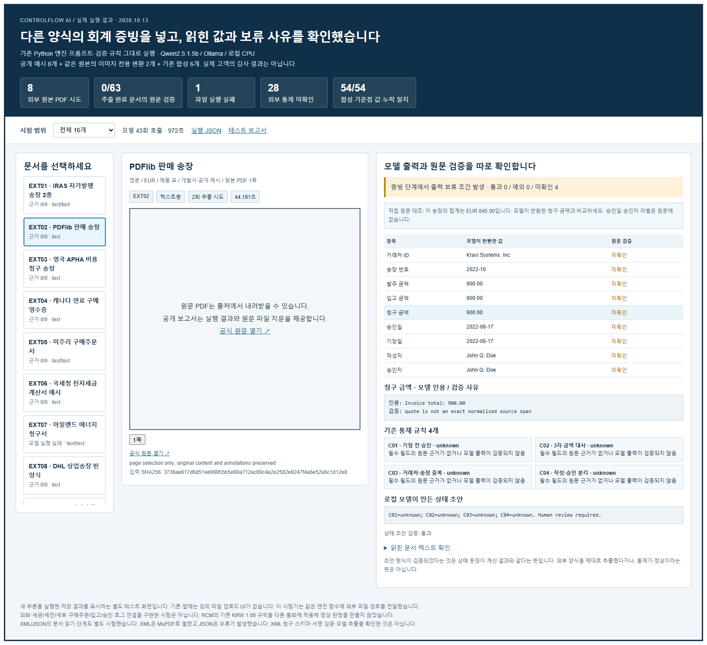
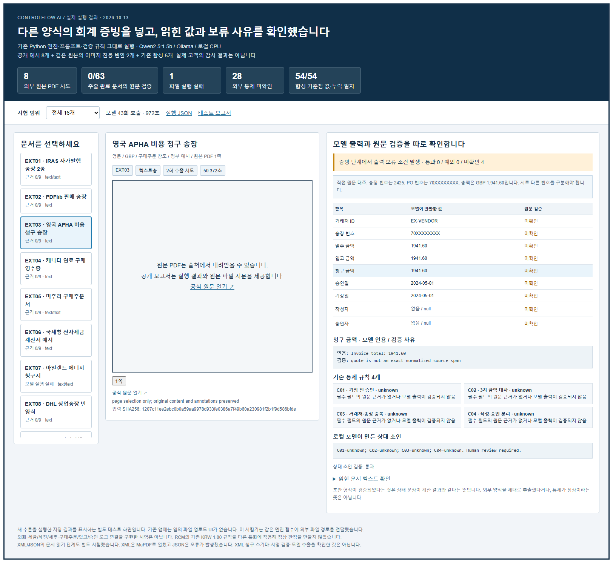
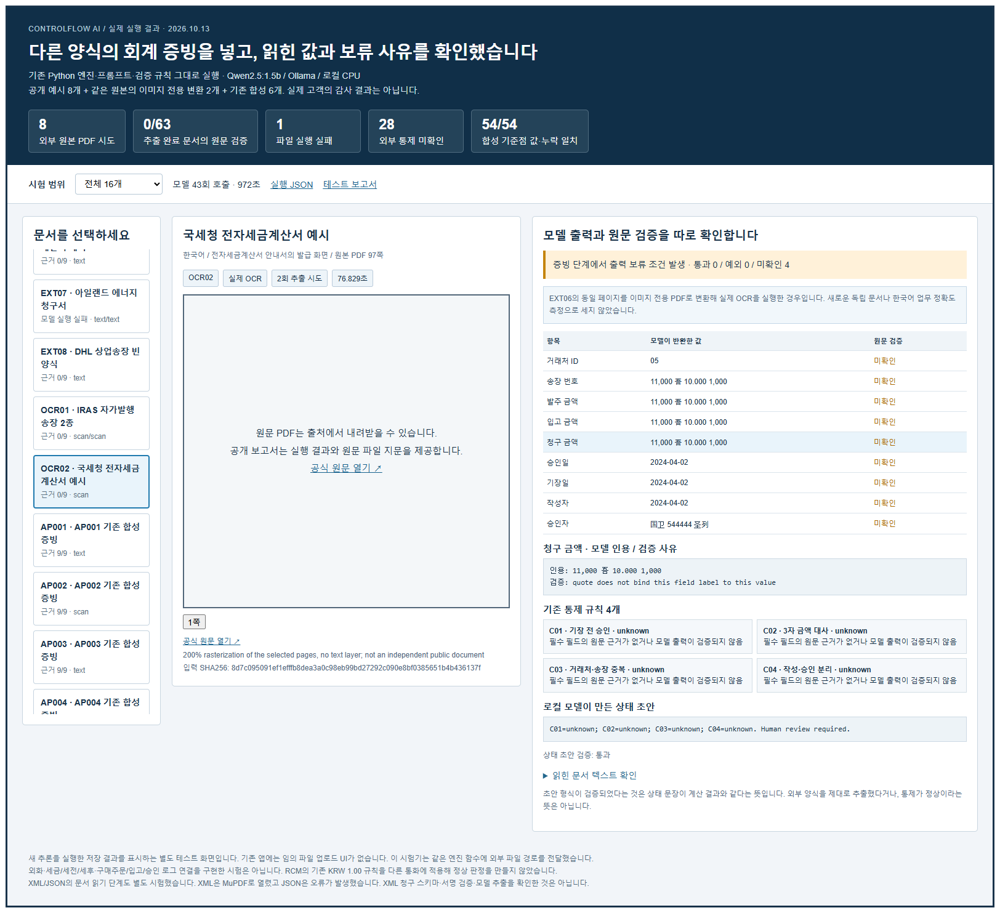
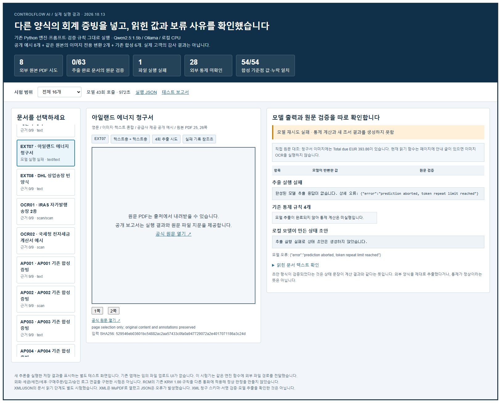
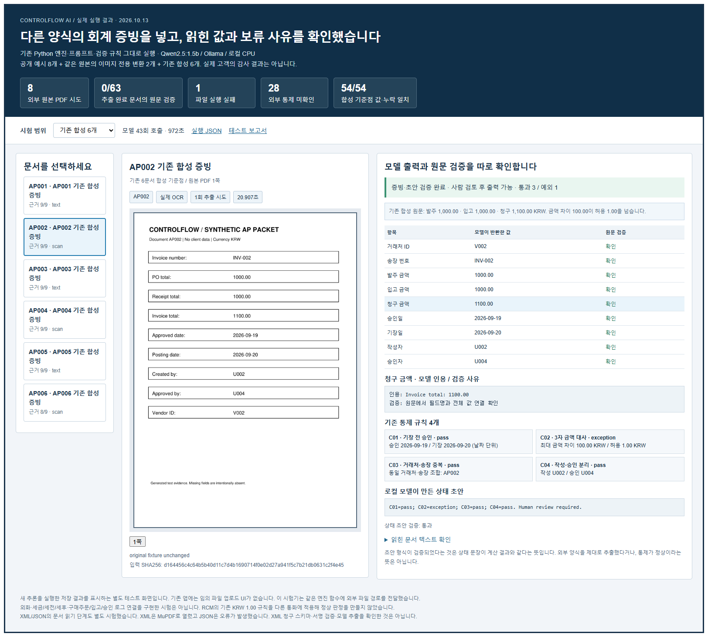

# 다른 양식의 회계 증빙을 넣고 읽힌 값과 보류 사유를 확인했습니다

2026-10-13 실행. 기존 `engine.py`의 OCR·Qwen 추출·원문 검증·통제 계산·상태 초안 함수를 그대로 호출했습니다. 임의 파일 업로드 UI를 새로 구현한 시험은 아닙니다. 기존 앱의 합성 실행 결과와 검토 이력은 변경하지 않았습니다.

공개 원본 PDF 8개를 선택해 시험했습니다. 문서 양식은 세금 송장, 제품 판매 송장, 비용 청구 송장, 연료 영수증, 구매주문서, 한국어 세금계산서 발급 화면, 에너지 청구서, 빈 상업송장입니다. 대부분 교육·개발·정부 안내용 예시입니다. 에너지 청구서는 세무당국이 공급사에서 받아 공개한 마스킹된 예시입니다. 실제 고객의 거래·ERP·감사 결과로 표시하지 않습니다.

## 실제 결과

| 범위 | 입력 수 | 원문 검증을 통과한 비어 있지 않은 값 | 통제 상태 | 증빙 단계 보류 조건 |
|---|---:|---:|---|---:|
| 외부 원본 PDF | 7 | 0/63 | {'unknown': 28} | 7개 |
| 같은 원본의 이미지 변환 | 2 | 0/18 | {'unknown': 8} | 2개 |
| 기존 합성 기준점 | 6 | 53/54 | {'pass': 18, 'exception': 5, 'unknown': 1} | 1개 |

외부 원문 검증 수는 정확도 점수가 아닙니다. 프로그램이 지원하는 고정 필드명·인용 형식으로 근거를 확인한 수입니다. 원래 없는 발주·입고·승인 정보도 포함되므로 이 수치로 모든 모델 값이 틀렸다고 단정할 수 없습니다. 빈 양식, 여러 예시를 한 페이지에 모은 자료, 구매주문서도 범위에 포함되어 있습니다. 하나의 송장으로 3자 대사나 ERP 권한 통제를 완료할 수 없습니다.

외부 PDF **8개를 시도해 7개가 추출·초안 단계까지 완료**, 1개는 모델 재시도 실패로 끝났습니다. 실패한 입력을 null 값이나 임의의 통제 상태로 대체하지 않았고, 위 값 검증의 분모 63개 항목에서도 제외했습니다. 외부 원본 8개를 모두 성공 처리했다고 표시하지 않습니다.

기존 합성 6개는 정답·누락 대조 **54/54**였습니다. 이 평가는 외부 파일과 분리했습니다. 합성 기준점에는 문서에 없는 승인자를 null로 반환해야 하는 항목 1개가 포함됩니다.

| 입력 | 종류 | 읽기 방식 | 원문이 뒷받침한 값 | 통과 / 예외 / 미확인 | 상태 초안 검증 |
|---|---|---|---:|---|---|
| EXT01 | IRAS 자가발행 송장 2종 | text/text | 0/9 | 0 / 0 / 4 | 통과 |
| EXT02 | PDFlib 판매 송장 | text | 0/9 | 0 / 0 / 4 | 통과 |
| EXT03 | 영국 APHA 비용 청구 송장 | text | 0/9 | 0 / 0 / 4 | 통과 |
| EXT04 | 캐나다 연료 구매 영수증 | text | 0/9 | 0 / 0 / 4 | 통과 |
| EXT05 | 미주리 구매주문서 | text/text | 0/9 | 0 / 0 / 4 | 통과 |
| EXT06 | 국세청 전자세금계산서 예시 | text | 0/9 | 0 / 0 / 4 | 통과 |
| EXT08 | DHL 상업송장 빈 양식 | text | 0/9 | 0 / 0 / 4 | 통과 |
| OCR01 | IRAS 자가발행 송장 2종 | scan/scan | 0/9 | 0 / 0 / 4 | 통과 |
| OCR02 | 국세청 전자세금계산서 예시 | scan | 0/9 | 0 / 0 / 4 | 통과 |
| AP001 | AP001 기존 합성 증빙 | text | 9/9 | 4 / 0 / 0 | 통과 |
| AP002 | AP002 기존 합성 증빙 | scan | 9/9 | 3 / 1 / 0 | 통과 |
| AP003 | AP003 기존 합성 증빙 | text | 9/9 | 3 / 1 / 0 | 통과 |
| AP004 | AP004 기존 합성 증빙 | scan | 9/9 | 3 / 1 / 0 | 통과 |
| AP005 | AP005 기존 합성 증빙 | text | 9/9 | 2 / 2 / 0 | 통과 |
| AP006 | AP006 기존 합성 증빙 | scan | 8/9 | 3 / 0 / 1 | 통과 |
| EXT07 | 에너지 청구서 | 텍스트 읽기 완료 / 모델 재시도 실패 | 추출 결과 미생성 | 통제 계산 미실행 | 초안 미생성 |

## 원문과 모델을 직접 대조한 사례

- **PDFlib 제품 송장:** 원문 송장 번호는 `2022-10`, EUR 합계는 **845.00**입니다. 이 실행에서 모델의 청구 금액은 **900.00**입니다. 원문에 없는 승인일·승인자 인용도 검토해야 합니다. 기존 검증기는 이 실행에서 원문 근거가 없다고 처리했습니다.
- **영국 APHA 송장:** 송장 번호 **2425**와 구매주문 번호 **70XXXXXXXX**가 따로 있습니다. 모델이 송장 번호로 **70XXXXXXXX**, 청구 금액으로 **1941.60**를 반환했습니다. 총액 원문은 **1,941.60**입니다. 원문에 없는 `Invoice total:` 인용 형식은 검증되지 않았습니다.
- **IRAS 자가발행 송장:** 첫 예시의 세전 합계 **33,915.00**와 납부 금액 **36,289.05**가 따로 있습니다. 모델의 청구 금액은 **33,915.00**입니다. 두 송장 예시의 분리와 세전·세후 정의가 필요합니다.
- **한국어 세금계산서 발급 화면 / 에너지 청구서:** PDF 안내 글은 텍스트층으로 읽혔지만, 이미지 안의 값은 원래 입력에서 OCR되지 않았습니다. `read_evidence()`는 페이지에 텍스트가 조금이라도 있으면 OCR을 생략합니다. 한국어 화면을 이미지 전용으로 바꾼 별도 입력에서 실제 OCR을 실행했습니다. 이 경우도 현재 고정 영문 필드의 원문 검증 조건을 통과하지 못했습니다.
- **DHL 빈 양식:** 화면은 정상적인 빈 상업송장인데 추출된 문자층은 인코딩이 깨져 있습니다. 모델이 값을 반환하더라도 실제 거래 값이 있는 문서로 인정할 수 없습니다.

위 숫자는 source preview를 사람이 대조한 관찰입니다. 전체 외부 문서에 대한 정답 세트나 일반화된 정밀도·재현율을 구축한 것은 아닙니다.

## 실패와 보류 기능도 확인했습니다

- 추론 중 HTTP 500 실패: **2회**, 모두 EXT07의 검증 실패 후 모델 재시도입니다. 동일 조건의 명시적 재시험에서도 `prediction aborted, token repeat limit reached`로 실패했습니다. 원래 실패를 삭제하지 않았습니다. `result.json`의 `errors`와 `explicit_retest_scope`를 참고하세요. 시험기는 파일별 실패를 기록하고 다른 파일을 계속 시험했으며, 원래 서비스의 `Engine.execute()`는 이 모델 오류가 발생하면 실행 실패로 종료합니다.
- 실제 `Engine.review()`와 `Engine.export()`를 격리된 테스트 경로에서 호출했습니다. 외부 원본·이미지 변환 총 **9개**의 조서 출력이 차단되었습니다. 검토 기록은 자동화 QA 기록이며 실제 감사인 판단이 아닙니다.
- AP002 합성 기준점 선택 출력: **True**. 예외를 정상으로 바꾸지 않고 선택 출력이 가능한지 확인했습니다.
- 기존 의미 있는 회귀 테스트 **15개 통과**. 결과의 값·인용문을 선택된 마지막 모델 응답과 직접 대조했고, 입력 SHA256과 실행 코드 SHA256도 확인했습니다. 코드가 모델 값을 정답으로 대체하지 않았습니다.
- XML: MuPDF가 텍스트 문서로 열었습니다. XML 송장 스키마·서명 검증과 모델 추출 시험은 아닙니다. JSON: 파일 열기 단계에서 `FileDataError`가 발생했습니다. 두 항목은 모델 호출 **0회**의 읽기 단계 시험입니다.

## 실행 환경과 범위

- 모델: `qwen2.5:1.5b`, `Q4_K_M`, 로컬 CPU.
- 모델 digest: `65ec06548149b04c096a120e4a6da9d4017ea809c91734ea5631e89f96ddc57b`.
- engine.py SHA256: `e05177d291818fd7432f37154793a3e3cd870a9cab6790154843169f6e1a0ed6`. 실행 전후 코드 일치: `True`.
- 모델 요청: 성공 응답 41개 + HTTP 실패 2개 = **43회**. 완료된 모델 응답의 개수와 파일 수를 혼동하지 않습니다.
  요청 수는 이 한 번의 최초 실행과 명시적 재시험에 대해 보존된 응답 파일·실패 단계로 재구성한 값입니다. 직접 수집한 API 요청 원장으로 표시하지 않습니다. 시험기는 기존 응답이 있는 출력 경로의 재사용을 거부합니다.
- 기록된 모델·문서 처리 시간: 972.2초. 다운로드·보고서·화면 촬영은 포함하지 않으며 사람 업무 시간 절감률로 해석하지 않습니다.
- `temperature=0`, `seed=42`, `num_ctx=4096`, `num_thread=6`, `num_gpu=0`. 같은 설정이 모든 환경에서 동일한 모델 출력을 보장하지는 않습니다.
- 원격 연결은 확인했지만 여유 RAM 약 0.9GB로 모델 실행에 부족했습니다. 로컬 여유 RAM 약 10GB를 확인해 순차 실행했습니다.
- C03 계산에 전달한 그룹은 합성 6개, 외부 추출 완료 7개(실패 1개 제외), 변환 2개입니다. 외부 전체 8개의 완전한 모집단 검증을 마쳤다고 표시하지 않습니다. 외부 완료 그룹도 거래처·송장 근거가 없어 C03가 모두 미확인입니다. 변환본을 원본의 중복 거래로 세지 않았습니다. 기존 RCM 설명의 `six-document population` 문구는 그대로여서 임의 모집단 업무 적용에 맞게 일반화된 설계는 아닙니다.

## 다음에 바꿔야 할 부분

1. 문서 종류·언어·통화와 금액의 세전/세후 의미를 먼저 구분하고, 송장 번호와 PO 번호의 매핑을 명시합니다.
2. 텍스트층이 있는 페이지에서도 이미지 영역의 OCR 필요 여부를 확인합니다. 잘못된 문자 인코딩도 별도로 탐지해야 합니다.
3. 정확히 같은 영문 라벨을 강제하는 검증을 문서별 필드 매핑·페이지/영역 근거로 확장합니다. 원문에 없는 필드를 추측하는 것은 계속 거부해야 합니다.
4. 서로 다른 발주·입고·송장·승인 자료를 거래별로 연결하고 통화·세금 기준을 확인한 뒤 통제를 계산합니다.
   여러 페이지에 대해 현재 초안 컨텍스트 출처 ID는 `문서:p1`에 고정되어 있습니다. 실제 페이지와 거래별 출처를 보존하는 구성도 필요합니다.
5. 학습 예시와 다른 정답 문서 세트를 만들어 값 정확도, 누락 처리, 근거 연결을 따로 측정합니다.

현재 시험은 위 확장을 구현한 결과가 아닙니다. **기존 합성 양식은 처리하지만 외부 양식의 자동 추출은 아직 부족하고, 잘못된 값에 대한 보류 장치는 작동한다**는 범위의 결과입니다.

## 출처와 파일 보관

`sources.json`은 원본 URL·크기·SHA256, `input-manifest.json`은 선택한 원본 페이지·입력 지문·변환 여부를 기록합니다. 공공기관의 과거 세율·기한을 현재 규정으로 적용하지 않았습니다. 공개 저장소에는 다운로드한 제3자 PDF 전체, 전체 추출 문서 텍스트, 공급사 자료를 포함하지 않았습니다. 원문은 출처 링크로 제공합니다.

별도 테스트 화면은 실제 저장된 새 실행 결과를 표시합니다. 기존 서비스의 임의 파일 업로드 기능이 있는 것처럼 보이지 않게 구분했습니다. 조사 에이전트는 공개 출처만 찾았고, 루트가 파일 확인·실행·통합·검증을 진행했습니다. 사용자 요청으로 진행한 테스트이며 구현과 테스트 코드 작성에 Codex 지원이 포함됩니다.

## 실제 실행 결과 화면

### 금액과 원문 근거

원문 합계 845.00에 대해 모델은 900.00을 반환했습니다. 원문 인용 검증을 통과하지 못해 통제가 모두 미확인으로 남았습니다.

### 송장 번호와 구매주문 번호 구분

송장 번호 2425 대신 PO 번호 70XXXXXXXX를 반환했습니다. 총액을 읽더라도 원문에 없는 인용문을 만들면 검증되지 않습니다.

### 한국어 이미지의 OCR 시험

같은 원본의 변환 사례이며 독립 문서 수나 일반적인 한국어 OCR 정확도로 세지 않았습니다.

### 모델 실행 실패도 보존

EXT07의 동일 조건 재시험도 HTTP 500으로 실패했습니다. 추출값과 통제 상태를 생성해 대체하지 않았습니다.

### 합성 기준점의 금액 예외 재현

기존 합성 양식에서는 9개 필드의 원문 근거를 확인하고 100원 차이를 예외로 표시했습니다. 실제 거래를 감사한 결과는 아닙니다.
